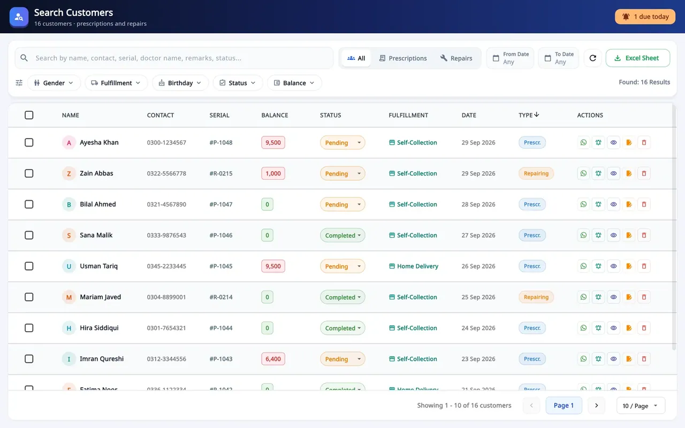
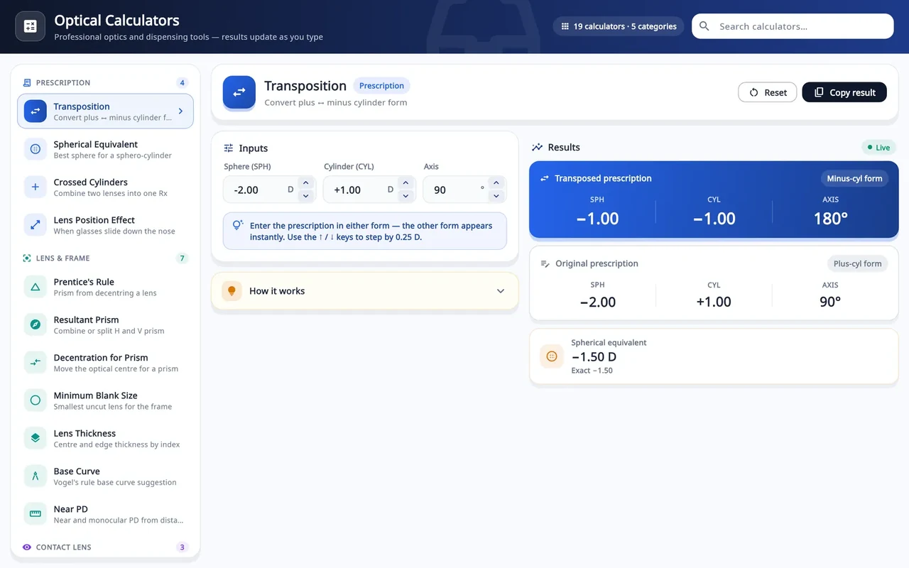
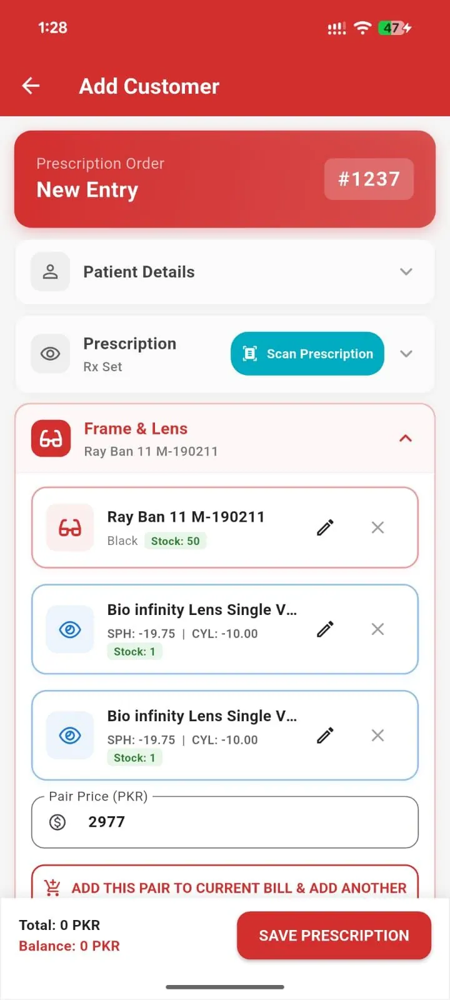
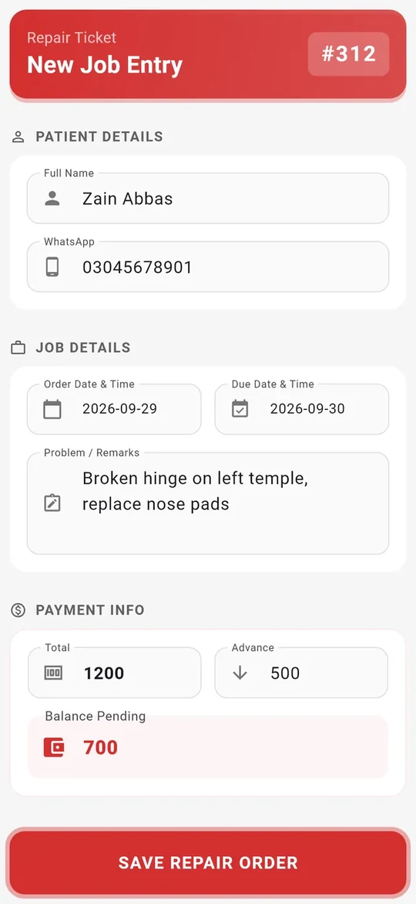
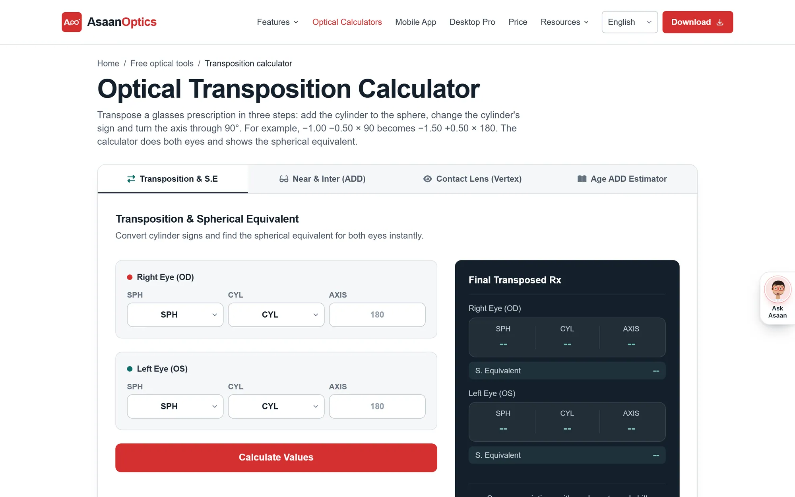

  

<h1 align="center">Asaan Optics</h1>

  <strong>Optical shop software for Android and Windows: prescriptions, counter sales, stock and staff shifts on one shared shop account.</strong>

  
  
  

  
   
  The Windows dashboard, shown with demo data.

---

## About

Asaan Optics is a subscription product for opticians, eyewear stores and eye clinics. It replaces the paper register with one shop account that works from a Windows PC at the counter and an Android phone: patients and eye prescriptions, spectacle orders and repairs, frame, lens and contact-lens stock, counter sales, staff shifts and receipts.

It started with optical shops in Pakistan and now also supports the languages and tax rules of Saudi Arabia, the Gulf and India. Both apps keep working when the internet drops.

Asaan Optics is published by [Techwine Solutions](https://www.techwinesolutions.com). It was designed and built by [Farhad Nazir](https://farhadnazir.com), its founder and sole developer.

> **About this repository.** This is the public showcase for Asaan Optics. It contains this README and product screenshots only. The product's source code (apps, backend and website) is private and is not published here. To use the software, install it from the links below.

## Platforms and downloads

| Platform | Get it | Details |
|---|---|---|
| **Android** | [Google Play](https://play.google.com/store/apps/details?id=com.techwinesolutions.asaanoptics) | Free to install, with paid plans through Google Play |
| **Windows 10 / 11 (64-bit)** | [asaanoptics.com/download](https://asaanoptics.com/download) | Self-updating installer, 30-day free trial |

There is no iPhone or iPad app at this time.

On Google Play the app is rated **4.8 from 116 reviews** (Pakistan storefront, November 2026). Release notes for both apps are on the [What's new](https://asaanoptics.com/whats-new) page.

## Key features

**Patients and prescriptions**
- Customer records with search by name, phone, serial, doctor or remarks, filters for status, balance, fulfilment and birthday, and Excel export.
- Prescription orders with SPH, CYL, AXIS, ADD, IPD and PD for each eye, frame and lenses picked from stock, several pairs on one bill, and advance and balance due.
- Prescription scanning on Android: the camera reads a printed prescription on the phone with on-device text recognition (OCR), and a parser checks the values against optical rules and highlights anything doubtful for staff to confirm.
- Repair jobs with their own serial series, status, balance and receipt.
- Eye screening aids on Android: a tumbling-E acuity chart calibrated to the phone's screen, an Amsler grid, a colour test and a pinhole record, saved to the customer. These are screening aids, not a diagnosis.

**Sales, receipts and tax**
- Counter sales by barcode or search, with discounts and cash, card or other payment methods, plus shop expenses on the same screen.
- PDF receipts for A4 and thermal printers, including Arabic text. The app prepares the receipt message and opens the customer's WhatsApp chat for staff to send.
- Saudi VAT receipts with a ZATCA QR code and GSTIN on Indian receipts. ZATCA Phase 2 e-invoicing is built into the Windows app and is switched on per device after onboarding.
- Sales statements filtered by type and date, exported to Excel or PDF.

**Inventory and barcodes**
- Separate stock for frames, spectacle lenses (single power or power range), contact lenses and accessories.
- Code 128 barcode labels for thermal sticker printers, read with a USB scanner on the PC or the phone camera.
- Stock Control Center: stock value at cost and retail, potential profit, stock by category, and alerts for low stock, out of stock and items not sold in 90 days.
- Supplier accounts with bills, payments and returns, and a spreadsheet import wizard for customers and stock.

**Staff, shifts and branches**
- Owner and staff logins with access set per screen.
- Shifts with X and Z reports, cash movements, manager PIN overrides and a staff audit log.
- My Branches (Windows): an owner with several shops sees each branch's sales, bills and low stock on one screen and can step into any branch.

**Tools, languages and security**
- 19 optical calculators in five categories, including transposition, vertex distance, spherical equivalent, Prentice prism, lens thickness and minimum blank size.
- Nine languages: English, Urdu, Arabic, Hindi, Turkish, German, Spanish, French and Portuguese, with right-to-left layouts for Arabic and Urdu.
- An offline help panel that answers how-to questions from a built-in product guide.
- Home-screen widgets on Android for quick actions, today's work and deliveries.
- Email or Google sign-in, a fingerprint or face lock on Android, in-app account deletion, and automatic background updates on Windows.

## Screenshots

### Windows desktop

All desktop screenshots use demo data.

<table>
  <tr>
    <td width="50%" align="center"> <b>Counter sale</b> with a serial number issued by the server</td>
    <td width="50%" align="center"> <b>Stock Control Center</b>: value, margins and alerts</td>
  </tr>
  <tr>
    <td width="50%" align="center"> <b>Customer search</b> with status, balance and fulfilment filters</td>
    <td width="50%" align="center"> <b>19 optical calculators</b> in five categories</td>
  </tr>
  <tr>
    <td width="50%" align="center"> <b>My Branches</b> for owners with several shops</td>
    <td width="50%" align="center"> <b>Arabic</b> with a full right-to-left layout</td>
  </tr>
</table>

### Android

  
  
  
  

<table>
  <tr>
    <td width="25%" align="center"> Prescription order with the scanner</td>
    <td width="25%" align="center"> Repair ticket</td>
    <td width="25%" align="center"> Acuity chart</td>
    <td width="25%" align="center"> Amsler grid</td>
  </tr>
</table>

### Website

  
   
  The product website, <a href="https://asaanoptics.com">asaanoptics.com</a>, also offers free optical calculators such as the <a href="https://asaanoptics.com/transposition-calculator/">transposition calculator</a>.

## How it is built

- **Apps:** Flutter and Dart for the Android app and the Windows desktop app.
- **Backend:** a multi-tenant REST API in Node.js and Express, with every signed-in request checked against the shop it belongs to.
- **Data:** TiDB Cloud (MySQL-compatible) in production, SQLite on each Windows till, and Firebase for sign-in and push notifications.
- **Offline-first:** writes carry an idempotency key and wait in a durable queue when the connection drops, so a sale is never recorded twice. Each till keeps its shift and cash ledger locally.
- **On-device OCR:** Google ML Kit text recognition reads prescriptions on the phone, with no cloud call.
- **Billing:** Google Play billing through RevenueCat on Android, and card checkout for desktop plans.
- **Releases:** GitHub Actions and fastlane ship the Android app to Google Play; the Windows app is an Inno Setup installer that checks a version manifest and updates itself.

## Links

- Website: [asaanoptics.com](https://asaanoptics.com)
- Android app: [Google Play](https://play.google.com/store/apps/details?id=com.techwinesolutions.asaanoptics)
- Windows app: [Download](https://asaanoptics.com/download) · [Desktop details](https://asaanoptics.com/desktop-details)
- What's new: [asaanoptics.com/whats-new](https://asaanoptics.com/whats-new)
- Video overview: [Asaan Optics in 2 minutes](https://www.youtube.com/watch?v=QN14SsmsQpw)
- Tutorials: [Asaan Optics Tutorials playlist](https://www.youtube.com/playlist?list=PLI9xnOxtXgaE) (37 videos)
- Case study: [How I built Asaan Optics](https://farhadnazir.com/projects/asaan-optics/)

## Author

**Farhad Nazir**, founder and sole developer of Asaan Optics, [Techwine Solutions](https://www.techwinesolutions.com).

- Website: [farhadnazir.com](https://farhadnazir.com)
- Email: [farhadnazirksa@gmail.com](mailto:farhadnazirksa@gmail.com)
- LinkedIn: [linkedin.com/in/farhadnazir](https://www.linkedin.com/in/farhadnazir)
- WhatsApp: [+966 53 656 6380](https://wa.me/966536566380)
- GitHub: [github.com/farhadnazir](https://github.com/farhadnazir)

---

  © 2026 Techwine Solutions. Asaan Optics is proprietary software; this repository does not include its source code.

